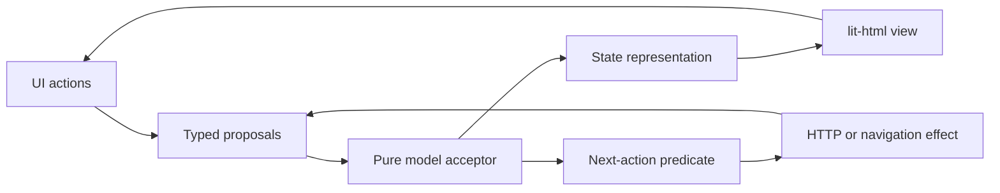

# Architecture and operation contracts

## Versioned onboarding

`features/onboarding/index.ts` owns the `harry-v2` operations, private media
lifecycle and verified appointment records. Its browser entry point composes
the shared SAM runtime with typed, correlated load/save/upload/booking effects.
File handles, upload authorization and OAuth secrets remain in effect closures;
the model contains answers, progress and owned media IDs, not signed URLs.

The server’s `eligible({ accountId })` checks the versioned completion record,
not the legacy profile flag. When `ONBOARDING_ENABLED=true`, authenticated page
routing redirects incomplete accounts to `/onboarding` and client HTTP dispatch
denies normal workflows before reaching their operations. Auth/sign-out and the
explicit onboarding endpoint set remain available. All legacy-complete clients
are subject to this gate, as explicitly requested by the operator.

Onboarding writes, finalized media, booking updates, resolutions and completion
serialize on an account-row lock. Content is read under a shared lock and kept
in immutable version archives. Completion revalidates the current answers and
evidence, then writes completion, updates the compatible profile and initializes
its first scorecard in one transaction. Existing dates/history are preserved.
Concurrent deletion or booking cancellation cannot race a stale revision into an
unlock. Later deletion does not undo the historical completion attestation.

Consent acknowledgements include document versions, signed name, health answers
and server timestamps. Medical audit alternatives are distinct from training
clearance. A client profile save cannot forge the new completion version or
change the server-owned clearance fields. Trusted review/resolution tools have
no public client override endpoint.

Optional marketing permission has a separate document configuration, revision and
append-only account event history. Its typed operations are exported from the same
feature interface. Each grant/withdrawal retains its exact versioned release and
server timestamp. Authenticated HTTP derives ownership from the session. Marketing
does not enter completion requirements or alter health-consent evidence. Its SAM
draft/effect stays editable after completion, independently of the locked assessment;
withdrawal remains possible under an unapproved replacement release. External
publication and removal remain operator responsibilities.

S3-compatible storage holds binary media outside PostgreSQL. Finalization checks
metadata and media signatures against a separate immutable ready key; database
metadata owns completion eligibility. Google Calendar confirmation requires a
provider-verified account binding and a Meet link; opening the configured
scheduling URL is not proof of booking. See
[onboarding operations](onboarding-operations.md) for provider setup, approval
prerequisites, limitations and rollout/rollback behavior.

## Brand presentation

`src/styles.css` owns the brand palette, derived semantic neutrals, font faces,
and shared presentation roles. All existing browser slices use the same dark
surfaces, Instrument Serif headings and Geist forms/data. Completion and selection
use neutral surfaces with textual/check indicators; olive is limited to small
section icons and the current navigation marker. Functional timers use Geist.

Fonts are self-hosted WOFF2 with accompanying OFL notices and explicit HTTP asset
routes. The build clears stale font output before copying the current assets.
No external font request or CSP exception is required. Sign-in uses these same
roles. The [brand findings](brand/brand-foundations.md) retain source direction;
the [implementation plan](brand/brand-implementation-plan.md) records application
choices and validation. This presentation change does not alter operations,
database schema, SAM transitions or authentication.

## Responsive client workspace

`src/shared/browser-layout.ts` renders the shared client shell. At 1024px and
above it provides persistent daily-practice, course and account navigation;
individual features provide their own templates and action callbacks. Links
respect each feature’s pending-write guard. Phone views keep the bottom scorecard
navigation and a single selected progress card. Desktop shows all three progress
cards using the same inputs and model, without duplicate editable fields.

Training separates exercise selection from its log/instructions/history. Courses
keep the episode list beside the lesson and tasks. Meals place capture beside saved meals and day history; review places current
totals beside ingredients, with history below. The Neural Map separates its guidance from
writing, then presents reading sections in a grid. Profile and L to R use bounded,
scrollable native dialogs with keyboard focus containment and restoration.

Account links from another workflow use `/?panel=profile` or `/?panel=setup`.
The browser validates that navigation intent and passes it to the scorecard
runtime. The acceptor opens the requested panel only after a correlated successful
load and consumes the intent once; retry and stale-load behavior are unchanged.
Setup review begins at its first step. Schema, authentication and ownership rules
remain the same.

## Client workflows and persistence

Each vertical slice exports its server contract through `index.ts` and its
browser contract through `browser.ts`. All operations take typed, named inputs,
return immutable data or a `Result` with stable codes, and derive identity from
the authenticated session at the HTTP boundary. Accounts have no access to each
other’s fitness records. This increment has no coach/administrator web UI.

| Slice | Core interface | Durable records |
| --- | --- | --- |
| profile | `createProfiles().get/save` | client_profiles, revisioned JSON |
| scorecard | pure metric/check/goal operations; `createScorecards().get/save/history/ensureStarted`; `adjustNutrition` | daily_scorecards, account/day + revision |
| training | `createTraining().get/save`, program scheduling and workout validation | workout_sessions, account/day + revision |
| learning | `createLearning().get/saveMap/readMap/hasRead/saveEpisode` | neural_maps, course_progress, map_reads |
| content | `createContentMedia().list/setVideo` (trusted writes only) | content_media, HTTPS direct media URLs |
| meals | `createMeals().get/analyze/log/remove/removeFavorite` | meal_entries, saved_meals, meal_analysis_limits |

Migrations 002–005 define these tables; Kanel generates the Kysely types from the
actual schema. External JSON is validated and reconstructed. Drafts are bounded.
Profile, scorecard, workouts, maps and lesson progress use compare-and-swap
revisions; a stale writer gets `conflict`, never silent last-write-wins. Initial
setup completion atomically records the server-owned start date and first daily
win. Acknowledgement timestamps are server-owned and preserved. The stored consent
version remains explicitly `draft-v1`; it is not an approved legal document.

`platform/client-http.ts` adapts the same operations under `/api/client/*`.
`createAuthenticatedHttp` checks the session, exact Origin, JSON content type and
CSRF header/cookie before invoking POST handlers. Clients cannot select their
account identity. Bodies are bounded to 256 KiB, or 6 MiB for meal analysis, with
eight simultaneous authenticated handlers per instance. Auth keeps its separate
4 KiB limit. Pages at `/`, `/training`, `/mindset/map`, `/courses/{pillar}` and
`/meals` require a session. CSP permits self-hosted scripts/styles/fonts and HTTPS
video, while blocking inline HTML/script execution.

The scorecard derives completion and targets from its saved profile and day.
Training and Map-read flags are canonical server data; a daily save cannot forge
them. Training enforces setup/health holds and future-day read-only rules. It
retains server-owned start/finish timestamps. Rest timers store a deadline, so
refresh/suspension does not extend the timer. History/PRs compare earlier completed
sessions of the same exercise. Course unlocking checks program week and completed
earlier weeks on the server, and completed tasks must have answers.

Browser behavior follows SAM: pure proposal acceptance, derived representation,
safe lit-html templates, and a once-per-ID effect dispatcher after rendering.
Every network result correlates both effect ID and kind; newer edits survive
in-flight saves and stale results are ignored. CSRF values live in transport
closures, never application models. Native dialogs trap/restore focus. Unsaved
writes block accidental page exit, and tab restoration refreshes server state.

## Independent meal integration

`createOpenAiMealAnalyzer` is the external-provider seam. It uses a fixed HTTPS
OpenAI Responses endpoint and `gpt-6-luna`, low reasoning effort, a strict JSON
schema, a 45-second timeout, bounded output, and `store: false`. Only the meal
description and selected photos are sent; profile, health answers and account
identity are excluded. API credentials remain in the server closure. Provider
payloads, URLs containing secrets and raw provider errors are never logged or
returned to clients. Missing configuration returns `not_configured`; manual meals
and saved meals continue to work.

The server validates photo signatures and base64, permits four JPEG/PNG/WebP
images of at most 1 MiB each, and accepts no remote image URLs. The browser resizes
and re-encodes selected photos, stripping file metadata. No photos or meal input
prompts are persisted. Output is validated again after JSON Schema parsing.
Ingredient nutrition is per 100 grams, portions are editable, and unknown
micronutrients remain null. AI values are labelled estimates with no claimed USDA
verification. The client must explicitly approve a review before logging.

Database reservations allow 10 attempts per client and 100 globally per 15-minute
window, with one active analysis per client and two globally. A global-first row
lock serializes reservations across replicas; a 60-second lease expires after a
crash, and release correlates its UUID so an old response cannot clear a new lease.
Provider throttling returns `rate_limited`; other temporary failures are sanitized.

Logging uses a client-generated UUID retained across retries. One transaction
inserts the account-scoped meal, optionally saves it to My Meals, and calls the
public scorecard nutrition adjustment with a locked day row. Duplicate identical
requests succeed without adding twice; reuse with different data conflicts.
Removing a meal subtracts its rounded contribution once. Removed entries retain
a tombstone so a late log retry cannot resurrect them. A failed daily limit check
rolls the whole meal transaction back. Manual scorecard edits use revisions, so
a stale tab cannot silently overwrite a newly logged meal. Snapshot responses
show up to 100 entries for a day and the 30 most recently saved meals.

## Layout

```text
src/
  features/auth/
    index.ts        # public server interface and composition exports
    browser.ts      # public browser interface and SAM/lit-html composition
    browser-model.ts   # pure proposal acceptance, representation, next-action predicate
    browser-runtime.ts # owns the model and dispatches each accepted effect once
    browser-effects.ts # typed HTTP actions and navigation, outside acceptance
    browser-view.ts    # pure lit-html template with action callbacks
    contracts.ts    # immutable inputs/results and private adapter interfaces
    operations.ts   # all authentication decisions; functions in a closure
    email.ts        # conservative mailbox normalization
    postgres.ts     # Kysely persistence, database time, transactions
    delivery.ts     # local outbox and remote email adapters
    http.ts         # HTTP transport, cookies, origin and CSRF checks
  platform/
    config.ts       # environment validation with a typed result
    application.ts  # composes the same operations with HTTP and assets
    database/       # connection, migrations, generated Kanel output
  shared/result.ts  # generic discriminated result only
  browser.ts        # browser entry
  server.ts         # process entry
```

Each new feature should own its operations, persistence implementation, UI, and
tests. The auth slice is the reference. Shared business rules must have a single
owner; vertical slices do not authorize duplicating invariants. The convention
check enforces feature entry points and forbids application classes and explicit
`any`. TypeScript checks readonly public records; negative type examples prove
these guarantees. Local implementation state may be mutable. This is compile-time
immutability, not deep runtime freezing of every object.

## SAM with lit-html

The browser follows State–Action–Model (SAM), adapting Abby's deterministic
`src/core/transition.ts` and external-effect pattern together with its separate
lit-html `dashboardView(state, actions)`. Abby's dashboard controller uses classes
and mutable fields; this project instead uses functions and an immutable model.



`acceptAuthUiProposal` is the sole owner of model changes. It checks whether an
action is allowed and returns a new readonly model containing any accepted effect
intent. `representAuthUi` derives the renderable state, including busy feedback;
`authView(state, actions)` produces a lit-html template without network calls or
model mutation. `nextAuthUiAction` selects the pending effect after acceptance.
The small runtime presents state before dispatch and runs each effect ID once.
HTTP actions validate JSON and propose typed results back to the acceptor, which
checks both effect ID and kind. Stale or duplicate results cannot change state,
sign in, or trigger another navigation. Disposed loops ignore late completions.

Link bearer tokens and CSRF values live in the effect closure, never in the model
or renderable state. Only inspected accounts can be explicitly confirmed. A
temporary redemption failure retains the account for an explicit retry; an invalid
link clears it. Successful redemption and sign-out schedule navigation as effects.
The server's auth operations remain authoritative for actual authentication;
browser acceptance cannot grant a session or bypass server checks.

The public `features/auth/browser.ts` exports the pure functions and headless
runtime as well as `mountAuth`, so tests and non-DOM callers use the same loop as
the UI. Headless tests cover purity, presentation-before-effects, duplicate and
stale proposals, retries and disposal; real-browser tests cover composed behavior.
There is no SAM library or generic framework added for hypothetical features.

## Agent-native interface

Core operations are ordinary typed functions callable without a browser or server.
The UI's HTTP adapter invokes these same operations. There is no separate set of
agent business rules, LLM dependency, or autonomous-agent framework.

```typescript
import { createAuth, createPostgresAuthStore, createLinkDelivery } from './src/features/auth/index.ts';
import { createDatabase } from './src/platform/database/connection.ts';
import { readConfig } from './src/platform/config.ts';

const configuration = readConfig(process.env);
if (!configuration.ok) throw new Error(configuration.error.code);
const config = configuration.value;
const db = createDatabase(config.databaseUrl);
const auth = createAuth({
  store: createPostgresAuthStore(db),
  deliverLink: createLinkDelivery(config.delivery),
  publicOrigin: config.publicOrigin,
  rateKey: config.rateKey,
});
try {
  const result = await auth.requestLink({ email: 'you@example.com', clientKey: 'trusted-tool-client' });
  // result is { ok: true, value: ... } or { ok: false, error: { code: ... } }.
  // The caller handles both branches; it must not treat acknowledgement as delivery.
} finally {
  await db.destroy();
}
```

Only trusted composition creates `Auth`; it validates configuration first and
injects storage and delivery. Untrusted HTTP clients never choose dependencies,
client rate keys, accounts, or session digests. Storage adapters may throw internally;
the public operations translate exceptions into the failure vocabulary below.

| Operation | Input object | Success value | Retry behavior |
| --- | --- | --- | --- |
| `provisionAccount` | `email` | readonly account `{ id, email }` | Idempotent for the normalized email; trusted administrative operation only |
| `requestLink` | `email`, `clientKey` | generic acknowledgement | Repeats may send another link and consume shared budgets; acknowledgement does not prove delivery |
| `inspectLink` | `token` | readonly account | Does not consume the link; token holders can see its destination account |
| `redeemLink` | `token` | account and session bearer token | Single use; one concurrent winner; a lost success response may require a new emailed link |
| `resolveSession` | `sessionToken` | readonly account | Refreshes idle expiry within the absolute deadline |
| `signOut` | `sessionToken` | `{ signedOut: true }` | Idempotent; success means the session is revoked or was already absent |

Expected failure codes are `invalid_input`, `invalid_link`, `unauthenticated`, and
`unavailable`. Browser JSON is runtime-validated. Direct callers must protect the
session bearer value returned by redemption; HTTP exposes it only as a cookie.
Unknown or throttled recipients and account-dependent delivery/storage failures
produce the same link-request acknowledgement. This is not a promise of identical
response timing. Provisioning is available as `npm run account:provision -- EMAIL`,
with structured JSON output; it has no public HTTP endpoint.

## Authentication behavior

- Accounts are explicitly provisioned. No passwords or public self-registration.
  Domain case is normalized; local mailbox case is preserved. This conservative
  policy may treat case variants of a provider's mailbox as different accounts.
- Tokens contain 32 cryptographically random bytes. PostgreSQL stores SHA-256
  digests, not bearer secrets. Links expire after 10 minutes.
- Link inspection and opening the confirmation page do not consume the token.
  The browser strips its fragment before requests. The user confirms the displayed
  account before a POST atomically consumes the challenge and inserts a session.
  Expiry is evaluated using database wall-clock time after acquiring the row lock.
- Sessions have a 30-minute sliding idle deadline capped at 8 hours. Logout deletes
  the session. Account deletion cascades to revoke its challenges and sessions.
- Shared rate windows allow 5 recipient requests, 20 client requests, and 200
  requests globally per 15 minutes. HMAC digests protect recipient/client keys.
  A global first-row lock orders reservations across application processes.
- All state-changing HTTP calls require exact Origin, JSON, and a CSRF header
  matching an HttpOnly cookie. Browser sessions use HttpOnly/SameSite cookies,
  `Secure` and `__Host-` names on HTTPS. Only loopback development permits HTTP.
- Auth documents and JSON use no-store; documents use restrictive CSP and
  no-referrer. The server serves only explicit asset paths. Request bodies,
  database waits and remote email delivery are bounded.
- Expired auth rows are pruned on new link issuance; old rate rows are pruned
  during budget reservation. No general background job or retention framework.

## Temporary preview authentication

At the operator’s explicit request, `signInHarryPreview({ alias, clientKey })`
permits the fixed `harrybaldwin` alias only when `AUTH_HARRY_PREVIEW=true`.
The dedicated `harrybaldwin@preview.invalid` account must be provisioned through
the trusted account CLI. The caller cannot choose an account ID or another email.
The operation reserves the existing persistent auth budgets, issues and atomically
redeems an internal challenge, and returns a normal session to the HTTP adapter.
No link or token enters a browser model or JSON response.

`POST /api/auth/harry-preview` uses the same exact-origin, JSON and CSRF checks as
magic-link redemption, then sets the normal HttpOnly/Secure session cookie.
The SAM acceptor schedules this effect only for the exact alias (case/whitespace
normalized), checks its completion ID/kind, and navigates after server success.
HTML email validation is retained for ordinary addresses. Preview access has the
same account ownership boundaries, expiry and sign-out as other client sessions.
Disabling the flag also denies existing preview sessions during resolution.
Anyone with the alias has access to this shared preview account while enabled;
it is an explicit temporary exception to email ownership verification.

## Operational limits

Account ownership authorizes the client operations above. There is no coach role,
account management UI, email-change flow or session dashboard. Final screening/
consent copy and videos remain unconfigured. There is no distributed email
outbox/retry worker: a link
request is acknowledged without promising successful provider delivery. Failed
delivery revokes its challenge. Remote provider tests are stubbed; actual email
delivery is unverified until separately configured and checked.

The development outbox contains bearer links and must remain local and ignored.
Changing `AUTH_RATE_KEY` resets request-budget identities. Existing sessions are
revoked by deletion or expiry, not by changing that rate key. A reverse proxy's
socket identity is shared by its callers unless a future explicit trust policy
is added. The default client budget may need configuration for that deployment.

### Meal review presentation and navigation

Meal number validation has one authoritative owner in the meal data module.
The browser represents draft field errors and logging eligibility from the same
limits used by `parseMeal`; invalid text stays in the draft for correction.
Entering review triggers one focus/scroll effect after rendering. Further edits
retain the user's position. Attempted invalid submissions can reveal the first
field error; transport failures reveal their retry feedback.

Meal links propose a navigation intent. An unfinished draft/capture queues a
confirmation effect; only its correlated acceptance queues navigation. Cancelling
retains the draft, and uncertain writes remain frozen for their existing safe
retry. Browser Back/Forward use the same feature-owned leave policy as links; refresh and tab close retain native unload protection. No new local storage,
account records or schema are introduced. The shared shell's More popover uses
native dismissal/focus behaviour and derives active-route presentation from the
workspace page.

### Task transitions and feedback

Accepted setup steps, lesson selection and Map steps trigger focus/scroll effects
once after rendering; ordinary input and save completions retain editing context.
Adding a meal ingredient reveals and focuses its name. These effects do not alter
business state or perform network operations.

Training date switches hide the previous workout during loading. A failed switch
restores the loaded date in the picker and retains the requested date for Retry;
load results still correlate by effect kind and ID. Training responsive state is
accepted through a typed viewport proposal so there is one rendered rest timer:
a reserved mobile footer, or controls beside the desktop set log. Future Swap
respects the same read-only rule as logging.

Profile targets and workout set numbers reuse their server validation limits for
field feedback. Incomplete lesson submissions represent missing answer indices.
Phone scorecard transport failures own a feedback row above navigation; desktop
feedback remains sticky. Unsaved-day labels distinguish local completion from
persisted data. The current meal review summary sticks independently of history;
history follows the review grid, so its length cannot displace current actions.

### Persistent authenticated navigation

`browser.ts` owns one authenticated workspace shell and a content outlet. Feature
views render only their content and optional mobile footer. Lit updates shell
selection without replacing the sidebar, mobile navigation or their scroll state.
Scorecard Profile/setup intents reuse its runtime and typed route proposal, so
opening or closing those panels preserves local drafts. Other route transitions
dispose the previous runtime before mounting the next one.

`shared/navigation-model.ts` owns typed navigation requests, correlated server
resolution and leave authorization. Only ordinary, unmodified same-origin links
to known app paths are intercepted. Real hrefs support direct requests, refresh,
keyboard access and new tabs. Training changes its date query only after the
feature accepts a successfully loaded day. Same-URL clicks do not add history.

Route resolution requests JSON from the existing page handler. Session resolution
and the mandatory onboarding gate run before either HTML or JSON is returned;
client routing cannot grant access. All authenticated documents carry the same
configured private-upload origin in CSP so onboarding can enter the persistent
outlet. The rollout flag remains unchanged and defaults off. A changed account or
expired session starts a fresh authentication document after leave authorization.

Feature models expose a pure navigation policy shared with native unload
protection. Pending writes block leaving. Unsaved generations and raw input drafts
require explicit discard; uncertain meal writes remain blocked until their exact
idempotent retry or explicit reload is resolved. The router checks this policy
after route resolution, immediately before committing, so edits made during a
slow route request remain protected. Back/Forward first restores the active
history entry, then resolves and authorizes the requested entry. Cancellation or
failure retains the current URL and feature state; Retry retains the target.

Route disposal aborts HTTP requests and debounce timers, removes feature listeners
and intervals, and prevents late proposals from presenting or scheduling more
effects. Navigation resolution also rejects superseded completions. Accepted
transitions dismiss More, set the route title, reset content scroll and focus the
content region without moving sidebar scroll or overriding dialog focus.
