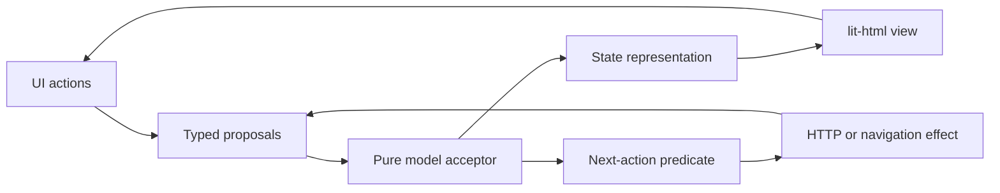

# Architecture and operation contracts

## Scorecard preview slice

`src/features/scorecard` owns the newly authorized product preview. `index.ts`
exports immutable data types and typed `Result` operations (`setMetric`,
`setDailyCheck`, `addGoal`, `selectPriority`) plus `representDay`. Target values
and tolerances are authoritative in `operations.ts`; representation and UI labels
use the same constants. `sample.ts` contains explicitly fictional Day 12 data.

The browser interface is `browser.ts`. Typed proposals pass through
`acceptScorecardProposal`; `representScorecard` derives tile completion and
progress views. Draft inputs are separate from committed values, so invalid
edits cannot corrupt the scorecard. Enter/blur commits and Escape restores the
committed value. The native-dialog next-action predicate runs after acceptance
and render, with duplicate dialog intents suppressed. The browser owns dialog
focus trapping and restoration. There are no network or storage effects in this
preview, and therefore no asynchronous scorecard completions to correlate.

`src/browser.ts` composes auth and scorecard through their public browser entry
points. Auth’s optional `presentHome` adapter receives only its renderable state
and sign-out action after session resolution. It mounts the scorecard once and
updates account/busy/error state thereafter without resetting scorecard edits.
Sign-out continues through the existing correlated auth SAM effects, including
error feedback and retry. No bearer values enter the scorecard.

Server authentication still gates `/`. There are no fitness HTTP endpoints or
schema changes. Every refresh reconstructs the labeled sample. Navigation to
later features opens explicit preview panels rather than claiming to submit or
save client information. Font assets are allowlisted individually and served
from the same origin under `font-src 'self'`; inline scripts/styles remain blocked.

## Layout

```text
src/
  features/auth/
    index.ts        # public server interface and composition exports
    browser.ts      # public browser interface and SAM/lit-html composition
    browser-model.ts   # pure proposal acceptance, representation, next-action predicate
    browser-runtime.ts # owns the model and dispatches each accepted effect once
    browser-effects.ts # typed HTTP actions and navigation, outside acceptance
    browser-view.ts    # pure lit-html template with action callbacks
    contracts.ts    # immutable inputs/results and private adapter interfaces
    operations.ts   # all authentication decisions; functions in a closure
    email.ts        # conservative mailbox normalization
    postgres.ts     # Kysely persistence, database time, transactions
    delivery.ts     # local outbox and remote email adapters
    http.ts         # HTTP transport, cookies, origin and CSRF checks
  platform/
    config.ts       # environment validation with a typed result
    application.ts  # composes the same operations with HTTP and assets
    database/       # connection, migrations, generated Kanel output
  shared/result.ts  # generic discriminated result only
  browser.ts        # browser entry
  server.ts         # process entry
```

Each new feature should own its operations, persistence implementation, UI, and
tests. The auth slice is the reference. Shared business rules must have a single
owner; vertical slices do not authorize duplicating invariants. The convention
check enforces feature entry points and forbids application classes and explicit
`any`. TypeScript checks readonly public records; negative type examples prove
these guarantees. Local implementation state may be mutable. This is compile-time
immutability, not deep runtime freezing of every object.

## SAM with lit-html

The browser follows State–Action–Model (SAM), adapting Abby's deterministic
`src/core/transition.ts` and external-effect pattern together with its separate
lit-html `dashboardView(state, actions)`. Abby's dashboard controller uses classes
and mutable fields; this project instead uses functions and an immutable model.



`acceptAuthUiProposal` is the sole owner of model changes. It checks whether an
action is allowed and returns a new readonly model containing any accepted effect
intent. `representAuthUi` derives the renderable state, including busy feedback;
`authView(state, actions)` produces a lit-html template without network calls or
model mutation. `nextAuthUiAction` selects the pending effect after acceptance.
The small runtime presents state before dispatch and runs each effect ID once.
HTTP actions validate JSON and propose typed results back to the acceptor, which
checks both effect ID and kind. Stale or duplicate results cannot change state,
sign in, or trigger another navigation. Disposed loops ignore late completions.

Link bearer tokens and CSRF values live in the effect closure, never in the model
or renderable state. Only inspected accounts can be explicitly confirmed. A
temporary redemption failure retains the account for an explicit retry; an invalid
link clears it. Successful redemption and sign-out schedule navigation as effects.
The server's auth operations remain authoritative for actual authentication;
browser acceptance cannot grant a session or bypass server checks.

The public `features/auth/browser.ts` exports the pure functions and headless
runtime as well as `mountAuth`, so tests and non-DOM callers use the same loop as
the UI. Headless tests cover purity, presentation-before-effects, duplicate and
stale proposals, retries and disposal; real-browser tests cover composed behavior.
There is no SAM library or generic framework added for hypothetical features.

## Agent-native interface

Core operations are ordinary typed functions callable without a browser or server.
The UI's HTTP adapter invokes these same operations. There is no separate set of
agent business rules, LLM dependency, or autonomous-agent framework.

```typescript
import { createAuth, createPostgresAuthStore, createLinkDelivery } from './src/features/auth/index.ts';
import { createDatabase } from './src/platform/database/connection.ts';
import { readConfig } from './src/platform/config.ts';

const configuration = readConfig(process.env);
if (!configuration.ok) throw new Error(configuration.error.code);
const config = configuration.value;
const db = createDatabase(config.databaseUrl);
const auth = createAuth({
  store: createPostgresAuthStore(db),
  deliverLink: createLinkDelivery(config.delivery),
  publicOrigin: config.publicOrigin,
  rateKey: config.rateKey,
});
try {
  const result = await auth.requestLink({ email: 'you@example.com', clientKey: 'trusted-tool-client' });
  // result is { ok: true, value: ... } or { ok: false, error: { code: ... } }.
  // The caller handles both branches; it must not treat acknowledgement as delivery.
} finally {
  await db.destroy();
}
```

Only trusted composition creates `Auth`; it validates configuration first and
injects storage and delivery. Untrusted HTTP clients never choose dependencies,
client rate keys, accounts, or session digests. Storage adapters may throw internally;
the public operations translate exceptions into the failure vocabulary below.

| Operation | Input object | Success value | Retry behavior |
| --- | --- | --- | --- |
| `provisionAccount` | `email` | readonly account `{ id, email }` | Idempotent for the normalized email; trusted administrative operation only |
| `requestLink` | `email`, `clientKey` | generic acknowledgement | Repeats may send another link and consume shared budgets; acknowledgement does not prove delivery |
| `inspectLink` | `token` | readonly account | Does not consume the link; token holders can see its destination account |
| `redeemLink` | `token` | account and session bearer token | Single use; one concurrent winner; a lost success response may require a new emailed link |
| `resolveSession` | `sessionToken` | readonly account | Refreshes idle expiry within the absolute deadline |
| `signOut` | `sessionToken` | `{ signedOut: true }` | Idempotent; success means the session is revoked or was already absent |

Expected failure codes are `invalid_input`, `invalid_link`, `unauthenticated`, and
`unavailable`. Browser JSON is runtime-validated. Direct callers must protect the
session bearer value returned by redemption; HTTP exposes it only as a cookie.
Unknown or throttled recipients and account-dependent delivery/storage failures
produce the same link-request acknowledgement. This is not a promise of identical
response timing. Provisioning is available as `npm run account:provision -- EMAIL`,
with structured JSON output; it has no public HTTP endpoint.

## Authentication behavior

- Accounts are explicitly provisioned. No passwords or public self-registration.
  Domain case is normalized; local mailbox case is preserved. This conservative
  policy may treat case variants of a provider's mailbox as different accounts.
- Tokens contain 32 cryptographically random bytes. PostgreSQL stores SHA-256
  digests, not bearer secrets. Links expire after 10 minutes.
- Link inspection and opening the confirmation page do not consume the token.
  The browser strips its fragment before requests. The user confirms the displayed
  account before a POST atomically consumes the challenge and inserts a session.
  Expiry is evaluated using database wall-clock time after acquiring the row lock.
- Sessions have a 30-minute sliding idle deadline capped at 8 hours. Logout deletes
  the session. Account deletion cascades to revoke its challenges and sessions.
- Shared rate windows allow 5 recipient requests, 20 client requests, and 200
  requests globally per 15 minutes. HMAC digests protect recipient/client keys.
  A global first-row lock orders reservations across application processes.
- All state-changing HTTP calls require exact Origin, JSON, and a CSRF header
  matching an HttpOnly cookie. Browser sessions use HttpOnly/SameSite cookies,
  `Secure` and `__Host-` names on HTTPS. Only loopback development permits HTTP.
- Auth documents and JSON use no-store; documents use restrictive CSP and
  no-referrer. The server serves only explicit asset paths. Request bodies,
  database waits and remote email delivery are bounded.
- Expired auth rows are pruned on new link issuance; old rate rows are pruned
  during budget reservation. No general background job or retention framework.

## Limits of the boilerplate

Authentication establishes an account, not application authorization. Add actual
product permissions when there are product operations to protect. There is no
multi-tenant model, account management UI, email-change flow, session dashboard,
or persisted fitness domain. The scorecard described above is an in-memory
product preview. There is also no distributed email outbox/retry worker: a link
request is acknowledged without promising successful provider delivery. Failed
delivery revokes its challenge. Remote provider tests are stubbed; actual email
delivery is unverified until separately configured and checked.

The development outbox contains bearer links and must remain local and ignored.
Changing `AUTH_RATE_KEY` resets request-budget identities. Existing sessions are
revoked by deletion or expiry, not by changing that rate key. A reverse proxy's
socket identity is shared by its callers unless a future explicit trust policy
is added. The default client budget may need configuration for that deployment.
